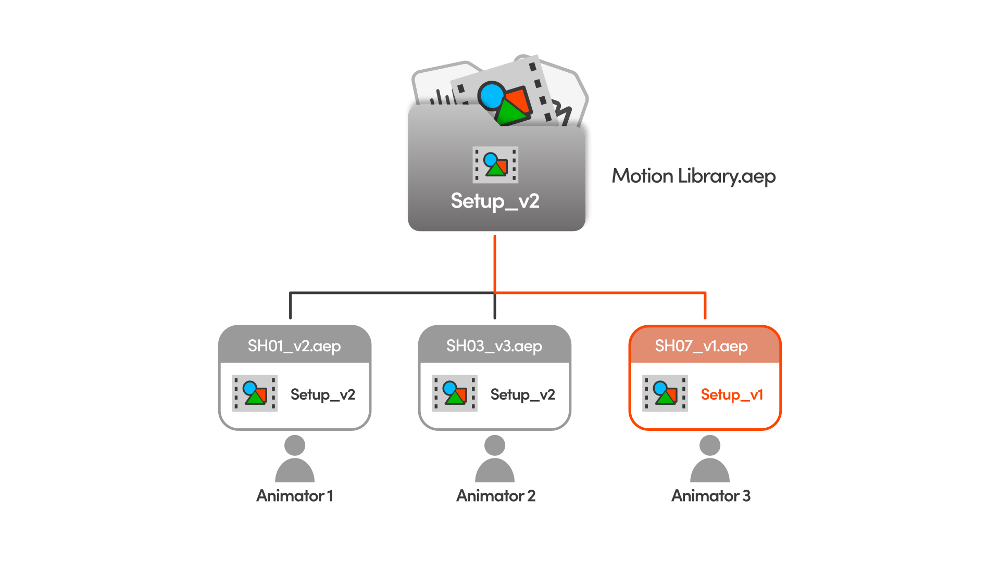

# Use Cases

---

AEP Transplant opens up many workflow possibilities. This section covers the most useful ones, each with a video and the best practices that keep it working on a real job.

---

<h2 id="motion-library">Motion Library</h2>

A Motion Library is an AEP project that holds the setups, animations, type treatments and brand assets you want to reuse, shared among the whole team.

Using a Motion Library and the right naming convention, your team stays on the same page, with consistency across the project and easy updates.

When the library changes, the [Update Watcher](features.md#update-watcher) makes it clear what's changed since you last loaded it. Re-import, and the old version is replaced in place. No duplicates, no messy imports.

Stop creating from scratch what's already been created by someone else, and move faster.

  <iframe src="https://www.youtube.com/embed/4hx9DuhP6o4" title="AEP Transplant | USE CASE 1: Motion Library" loading="lazy" allow="accelerometer; autoplay; clipboard-write; encrypted-media; gyroscope; picture-in-picture; web-share" referrerpolicy="strict-origin-when-cross-origin" allowfullscreen></iframe>

---

### Best practices

| Do this | Because |
| --- | --- |
| **Keep the library's file name constant** | It's what lets you take full advantage of the [Update Watcher](features.md#update-watcher) and the [Recent Projects](interface.md#recent-projects) list. I suggest making backups instead of bumping the library version. |
| **Bump the version in the comp name every time** | So everyone knows which version they have in their scene. |
| **One shared library, not a copy per animator** | Two copies drift apart, and then neither one is the source of truth. |

---

<h2 id="recover-keyframes">Recover Keyframes & Effects</h2>

Sooner or later something you simplified, stripped back or deleted days ago turns out to be wanted after all, and by then the comp has moved on so far that opening an older save and working from that would cost you every change you've made since.

Because AEP Transplant reads any `.aep` file, your own previous versions are a library too. Open the version that still has the animation, [import just that layer](features.md#layer-targets) straight into the comp you're working in, copy across the keyframes, effects or masks you came for, and delete the layer you borrowed.

The rest of your project never moves.

  <iframe src="https://www.youtube.com/embed/KvrhKxPYVRc" title="AEP Transplant | USE CASE 2: Recover Keyframes, Effects & more" loading="lazy" allow="accelerometer; autoplay; clipboard-write; encrypted-media; gyroscope; picture-in-picture; web-share" referrerpolicy="strict-origin-when-cross-origin" allowfullscreen></iframe>

The borrowed layer arrives with a number appended when the comp already has a layer of that name, so expressions on both versions stay pointed at the layer they were written for.

---

### Best practices

| Do this | Because |
| --- | --- |
| **Save incrementally, and keep the increments** | They're what you'll be reaching into. A version you overwrote is a version you can't borrow from. |
| **Aim it at the comp you're working in** | Use the [Target Picker](features.md#target-picker) on the layer so it lands beside the version you're fixing, ready to copy from. |

---

<h2 id="combine-projects">Combine Projects</h2>

Bringing shots, precomps and assets from several projects into one usually means a new folder for every import, duplicate footage and solids, and an hour of tidying before anyone can find anything.

With [Smart Merge](features.md#smart-merge), every incoming folder finds its match in your project, even when the names differ (`Bitmaps` into `Images`, `a.precomps` into `02_PRECOMPS`), and folds right in. Only what each comp actually uses comes along, and when something you already have shows up again, you choose: **Replace**, **Use Current** or **Keep Both**.

Footage stored outside the project can be [copied in alongside it](features.md#external-assets), so the combined project stays self-contained and ready to hand off.

One project, one structure, no duplicates.

  <iframe src="https://www.youtube.com/embed/g3aTOjZRG2I" title="AEP Transplant | USE CASE 3: Combine Projects" loading="lazy" allow="accelerometer; autoplay; clipboard-write; encrypted-media; gyroscope; picture-in-picture; web-share" referrerpolicy="strict-origin-when-cross-origin" allowfullscreen></iframe>

---

### Best practices

| Do this | Because |
| --- | --- |
| **Save the destination project first** | Footage can only be copied in once the panel knows where your project lives. |
| **Teach it your folder names** | If your team uses its own names, add them in [Folder Merge Settings](features.md#folder-merge-settings) so they match too. |
